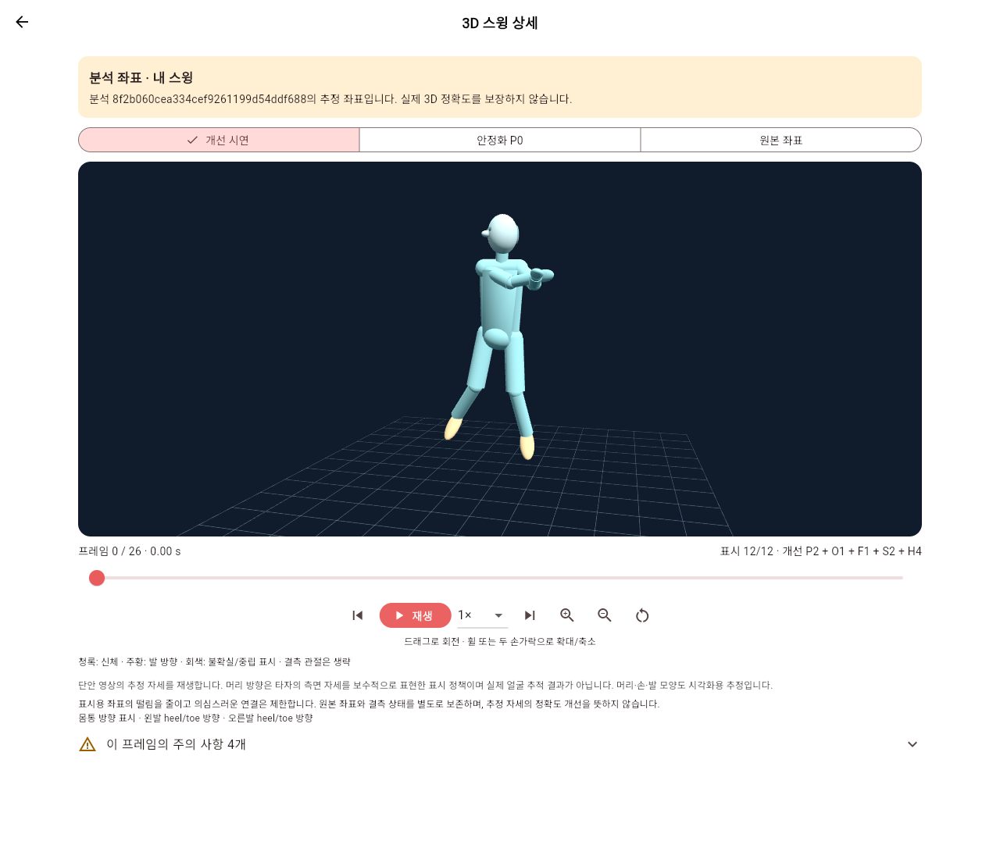

# 사용자 업로드 기반 3D 스윙 통합 검증

2026-10-28. `origin/main`의 `13cdca8`에서 만든 `feat/swing-3d-integration` worktree에 필요한 소스와 테스트만 이식했다. 원본 작업 폴더와 EXP-007/008은 보존한다. 이 문서는 코드 통합과 검증 결과이며 운영 배포 완료를 의미하지 않는다.

## 사용자 흐름과 변경 범위

기존 회원가입·bcrypt 로그인 → 실제 영상 업로드 → 기존 모델 `0.2-draft` 점수·관절/구간 피드백 → 동일 추론의 World 좌표 저장 → 종합 피드백의 **3D 스윙 보기** → 해당 분석 ID의 마네킹을 재생한다. 분석 기록에서도 같은 결과를 다시 조회한다.

- Flutter는 기존 라우터·테마·Session을 유지하며 `/analyses/:analysisId/pose-3d`를 추가한다. 실제 분석 화면에는 번들 선수 샘플이나 실패 시 샘플 대체 경로가 없다. 선수 좌표 asset과 실험용 demo 경로는 배포 대상에서 제외했다.
- P2 → S2는 서버에서 1회 처리한다. Flutter에서 O1 몸통, F1 양발, H4 머리 표시를 계산하며 카메라 조작과 분리한다. 원본/P0/개선 전환, 재생·정지·배속·프레임 탐색·회전·확대를 제공한다.
- 본체 청록, 머리 밝은 청록, 방향 강조 주황, 불확실한 방향 회색을 공통 스타일로 정의한다. 없는 관절을 임의로 채우지 않으며 전체 표시 불가 시 원인을 안내한다.
- 기존 IMAGE 좌표·전처리·모델 0.2 입력과 점수 계산은 유지한다. MediaPipe의 동일 호출에서 World와 heel/toe를 관찰하며 추가 추론하지 않는다. 3D 생성·저장 실패는 이미 완료된 점수를 실패로 바꾸지 않는다.
- 몸통·발은 추정 좌표에서 계산하며 H4는 보수적인 표시 정책이다. 실제 머리 시선이나 3D 모션 캡처 정답을 추정했다고 주장하지 않는다.

## 인증과 DB

기본 DB 스키마는 기존 `public`이다. 기존 users 행과 bcrypt 해시를 그대로 조회하며 실험의 계정 복사 방식은 포함하지 않는다. 로그인 응답에 서버가 검증하는 Bearer 세션을 추가했다. 토큰은 DB에 SHA-256으로 저장하고 Flutter 메모리에서만 보관한다. 앱 재시작/새로고침 후 재로그인이 필요하다.

기존 분석 ID와 소유권을 사용하며 무인증은 401, 다른 사용자 및 소유자 없는 기록은 403이다. 기존 3D 없는 분석은 점수·영상 조회를 유지하고 3D만 404로 안내한다. 구형 무인증 클라이언트는 더 이상 보호 API를 호출할 수 없으므로 API와 Flutter를 함께 배포해야 한다.

운영 사전 점검에서 public revision `0002`, users 8건, swings 20건, 소유자 없는 swings 7건을 확인했다. **운영 테이블·계정·분석은 수정하지 않았고 운영 migration은 미실행**이다. 7건의 소유권은 별도 증거 확인 없이 배정하지 않는다. 기존 `testuser01`을 포함한 public 계정의 새 API 로그인은 운영 migration 승인 후 검증해야 한다.

`0003`은 `auth_sessions`, `pose_3d`와 FK/index/RLS를 추가한다. 서버 시작 시 자동 DDL은 없다. 비공개 Storage는 서버만 접근하고 3D는 인증 API가 크기·해시·분석 ID를 검사한 뒤 반환한다. [migration 영향·백업·롤백·승인 절차](swing-3d-migration.md), [좌표 계약 및 처리 순서](swing-3d-pipeline.md)를 따른다.

## 실제 영상 E2E와 점수 회귀

사용자가 이전에 승인한 별도 Supabase 테스트 스키마·비공개 버킷에서 새 테스트 계정으로 실행했다. 운영 public 테스트나 개인 신규 촬영 영상 검증으로 해석하지 않는다. 기존 train 영상을 API에 실제 업로드했으며 HTTP/좌표 응답을 fixture로 바꾸지 않았다. 기존 원격 자료 삭제·이동과 공유 Storage 정책 변경은 수행하지 않았다.

| 입력 | 좌우타 | 실제 World 프레임 / PTS FPS | 점수 / 3D |
|---|---|---:|---|
| 한화_4_오재원 | 좌타 | 127 / 60 | done / ready |
| 롯데_17_윤동희 | 우타 | 88 / 60 | done / ready |
| 롯데_59_나승엽 | 좌타 | 27 / 30 | done / ready |

각 업로드의 SHA-256·분석 ID·소유자·좌우타·timestamp를 확인했다. 점수, 3D, 저장 영상, 기록 API의 본인 접근과 무인증 401·타인 403, 저장 재조회·영상 읽기·로그아웃 폐기를 검증했다. 세 영상의 6개 새 Storage 객체에서 서버 GET 206, 공개 URL/무인증 GET 400 차단을 확인했다. 실제 anon/authenticated DB 역할 검사도 수행했다. 실제 anon API 키 및 Supabase Auth 사용자 JWT를 넣은 HTTP 검사는 제공된 자격증명이 없어 미검증이다. 앱의 opaque 세션 A/B 검증과 구분한다.

통합 전후의 전체 점수·관절·구간·속도 피드백 값은 세 영상 모두 차이 0개였다. 기존 main 소스의 별도 읽기 전용 추론과 비교했으며 오재원 56.4, 윤동희 80.1, 나승엽 82.3으로 일치했다. 비교 양쪽 LLM은 껐고 job ID/시각은 점수 비교에서 제외했다. 이것은 세 회귀 입력에 대한 결과이며 모든 입력의 무회귀나 실제 3D 정확도 보증은 아니다.

| 검증 | 결과 |
|---|---|
| Flutter analyze | 이슈 0개 |
| Flutter VM tests | 228 통과, 웹 전용 3개 제외 |
| 기존 웹 전용 3개 | 실제 Chrome 3개 통과, 테스트 프로세스 exit 0 |
| Flutter Web build | 3.44.9 / Dart 3.12.2, 성공; three_js 0.3.0 고정 |
| 백엔드 단위·회귀 | 전체 124 통과/6 제외 후, 데이터 의존 5개 및 추가 보완·검증도구 19개 별도 통과. 고유 148개 실행 통과; 원격 opt-in pytest 1개 미실행 |
| 실제 Supabase API | 세 영상 생성·재조회·권한·영상 읽기 검사 통과. 위 단위 fixture와 구분 |
| 실제 Chrome 앱 | 34/34 검사 및 탐색·경고 추가 6/6 통과; 새 UI 업로드→피드백→자기 3D→재진입 성공, 런타임 예외 0 |
| 기존 모델 0.2 | 세 입력의 전체 보고서 수치 동일; 모델/가중치/기존 점수 소스 불변 |
| 보존 검사 | 원본 두 작업 트리 상태·보호 소스 285개 및 세 원본 영상 해시 동일 |

웹 전용 검사는 Windows Flutter SDK 테스트 서버가 CanvasKit 경로를 역슬래시로 바꿔 404를 반환하는 문제 때문에 처음에 시작되지 않았다. 로컬 검증 도구가 **설치된 SDK의 동일 CanvasKit JS/WASM 바이트만** Chrome에 제공해 테스트를 실행했다. SDK·앱·API 응답은 교체하지 않았다. 실제 Blob을 읽는 기존 widget 테스트의 fake clock 대기도 `tester.runAsync`로 수정했다. 원래 일반 명령이 Windows에서 그대로 통과한 것으로 표현하지 않는다. Linux CI는 이 로컬 우회 없이 같은 웹 테스트를 실행한다.

Chrome에서는 세 실제 업로드의 timestamp 재생, 원본/P0/개선 전환, 회전·확대와 머리 방향 분리, 0.25배속·일시정지를 확인했다. 별도 탐색 검사는 60FPS 영상에서 프레임 0→63, timestamp 1.05초와 경고 표시를 확인했다. 처음 자동화의 짧은 30FPS 클립 일시정지 검사는 종료 시점과 겹쳐 실패했으며 실패 기록을 보존했다. 재검사에서는 UI로 0.25배속과 시작 프레임을 선택한 뒤 실제 일시정지 상태를 확인했다. 앱 코드를 통과용으로 변경하지 않았다.

아래는 실제 Chrome에서 파일 선택으로 새로 업로드한 영상의 3D 화면이다. 원본 프로 선수 영상 파일이나 좌표 데이터셋은 이 이미지에 포함하지 않는다.

이번 검증에서 테스트 계정 2개, API 업로드 3건과 Chrome 업로드 1건 및 각각의 영상/3D 객체를 추가했다. 기존 테스트 자료는 삭제하지 않았다. 세 API 업로드의 6개 객체를 별도로 접근 감사했고, Chrome 추가 객체는 실제 앱의 저장·조회 경로로 검증했다. 정리하려면 검증 영수증의 해당 테스트 ID를 기준으로 별도 승인을 받고 수행한다. 운영 계정·운영 데이터 정리는 이번 범위에 포함하지 않는다.

GitHub Actions는 API/합성 기하 테스트와 Flutter analyze/VM/Chrome/Web build를 실행하도록 추가했다. CI의 데이터 의존 5개와 원격 opt-in 1개 제외는 로컬의 별도 실제 데이터·Supabase 검증과 구분한다. 실제 원격 CI 상태는 PR의 Checks를 기준으로 확인한다.

첫 Linux CI에서 MediaPipe의 native image 의존 라이브러리 누락 2건, Windows 경로를 가정한 로컬 저장소 테스트 1건, 갱신된 Swagger 설명의 기존 문자열 검사 1건이 실패했다. CI runner에 libegl1/libgles2를 명시하고, 경로 검사를 실제 플랫폼 절대 루트로 바꾸며, user_id 자체로는 인증할 수 없다는 설명을 유지했다. 검사 제거·skip 추가·운영 알고리즘 변경으로 통과시키지 않는다.

## 배포와 한계

- 본 통합은 단일 추론 worker 구조를 유지한다. 같은 DB에 동일 worker ID의 서버를 중복 실행하지 않는다.
- 손목/팔꿈치 오검출과 깊이 왜곡은 남는다. 표시 스무딩 개선은 실제 자세 정확도 향상 수치가 아니다.
- 30FPS를 거부하지 않으며 실제 PTS로 재생한다. 이번 기본 경로에는 표시용 프레임 보간 I를 적용하지 않는다.
- Android 실기기가 연결되지 않았고 flutter_angle이 요구하는 CMake 3.31.4 및 Build Tools 35.0.1이 없다. SDK를 설치하지 않았으며 Android 빌드·실행·터치·성능은 미검증이다.
- 공개 배포에는 HTTPS, 정확한 CORS origin, 로그인 속도 제한·복구/세션 운영 정책 검토가 필요하다. 운영 migration, 백업 복구 검증, 최종 사용자 승인 전에는 main 병합·운영 배포하지 않는다.

실제 비밀 설정·비밀번호·토큰·원본 영상·NPZ·모델 가중치·브라우저 프로필·로그는 새 Git 변경에 포함하지 않는다. 새 테스트 좌표는 기하학적으로 생성한 합성 자료다. 로컬 실행 영수증과 화면 캡처는 gitignore된 `.local/validation`에 보관한다.
